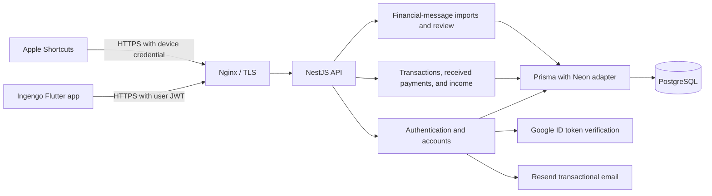
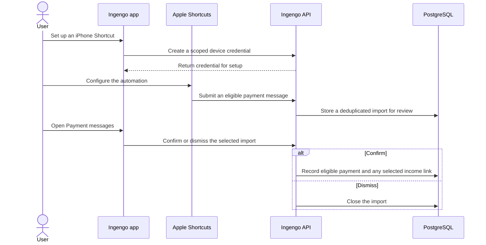
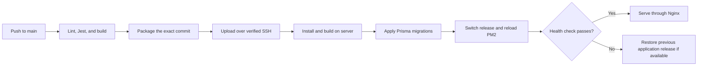

<div align="center">

# Ingengo API

**The open-source NestJS backend for Ingengo payments, income, and financial-message review.**

[](https://nodejs.org/)
[](https://nestjs.com/)
[](https://www.prisma.io/)
[](https://www.postgresql.org/)
[](LICENSE)

Ingengo helps people in Rwanda organize payment and income records. This repository
serves the [Ingengo Flutter client](https://github.com/nexcoderw/ingengo-app) and
owns the versioned HTTP API and PostgreSQL schema. The API quotes and records
payments, tracks the evidence behind their status, and imports eligible payment
messages for review. Payment providers handle the actual movement of funds.

[Ingengo App repository](https://github.com/nexcoderw/ingengo-app) ·
[Live API reference](https://ingengo-api.nexcode.africa/api/v1/docs) ·
[Local setup](#getting-started) · [Contributing](CONTRIBUTING.md) · [Security](SECURITY.md)

</div>

## Contents

- [Features](#features)
- [Architecture](#architecture)
- [API reference](#api-reference)
- [Getting started](#getting-started)
- [Configuration](#configuration)
- [Development checks](#development-checks)
- [Deployment](#deployment)
- [Security and privacy](#security-and-privacy)
- [Project history](#project-history)
- [Troubleshooting](#troubleshooting)
- [Contributing](#contributing)
- [Authors and license](#authors-and-license)

## Features

| Area | What it supports |
| --- | --- |
| Authentication | Google ID token verification, email one-time codes, password setup and sign-in, access and refresh tokens, and logout |
| Account management | Profile updates and account-deletion requests |
| Send Money | RWF quotes and fees, transaction categories, idempotent creation, payment-result evidence, and history and analytics |
| Received payments | Manual or SMS-derived records, evidence source, and classification |
| Income | Expected and received income, period totals, and links to eligible received payments |
| iPhone Shortcuts | Scoped device credentials, provider and version controls, and a review queue for confirming or dismissing imported payment messages |

## Architecture

NestJS controllers and DTOs define the versioned API and its Swagger contract.
Feature services own payment, income, and import rules. Prisma uses a Neon-backed
connection at runtime and versioned SQL migrations to evolve the PostgreSQL schema.



### iPhone Shortcut review

A user can provision a Shortcut credential from the app. Eligible messages enter
a review queue. Confirmation can record an incoming payment and optionally link
income according to the review request. Dismissal closes the import without
recording a payment. Pending message text is encrypted and expires under the
retention policy.



The [iPhone Shortcut rollout guide](IPHONE_SHORTCUT_ROLLOUT.md) covers pilot
verification and version enforcement.

### Repository map

| Path | Responsibility |
| --- | --- |
| [`src/modules/`](src/modules/) | Feature controllers, DTOs, services, and tests |
| [`src/config/`](src/config/) and [`src/common/`](src/common/) | Configuration, validation, guards and shared HTTP behavior |
| [`src/database/prisma/`](src/database/prisma/) | Prisma client and connection lifecycle |
| [`prisma/schema.prisma`](prisma/schema.prisma) and [`prisma/migrations/`](prisma/migrations/) | PostgreSQL model and migration history |
| [`test/`](test/) | End-to-end test configuration |
| [`deploy/`](deploy/) and [workflow](.github/workflows/ingengo-api-deploy.yml) | Production release script, process and proxy configuration, and CI/CD |

## API reference

The base path is `/api/v1`. Use the [interactive Swagger reference](https://ingengo-api.nexcode.africa/api/v1/docs)
or the [OpenAPI JSON](https://ingengo-api.nexcode.africa/api/v1/docs-json) for
request fields, authentication requirements, and response schemas. The routes
below are relative to that base path.

| Routes | Purpose |
| --- | --- |
| `POST /auth/google`, `POST /auth/email/initiate`, `POST /auth/email/verify`, `POST /auth/password/login` | Sign in and verify identity |
| `POST /auth/refresh`, `POST /auth/logout`, `GET /auth/me` | Manage an authenticated session |
| `GET /users/me`, `PATCH /users/me`, `POST /users/me/deletion-request` | View, update, or request deletion of an account |
| `POST /transactions/quote`, `POST /transactions`, `GET /transactions/history`, `GET /transactions/analytics` | Quote and record outgoing payments and query owned data |
| `GET /received-transactions`, `POST /received-transactions/manual`, `POST /received-transactions/provider-sms` | List or record incoming payment evidence |
| `GET /incomes`, `POST /incomes`, `POST /incomes/{id}/link` | Create and link income records |
| `POST /financial-message-imports/shortcut`, `GET /financial-message-imports`, `POST /financial-message-imports/{id}/confirm`, `POST /financial-message-imports/{id}/dismiss` | Import with a device credential and review with a user JWT |
| `GET /shortcut-import-credentials`, `POST /shortcut-import-credentials`, `POST /shortcut-import-credentials/{id}/rotate`, `DELETE /shortcut-import-credentials/{id}` | Manage Shortcut device access |

After starting the API locally, open Swagger or check the generated contract.

```bash
curl --fail --silent --show-error http://localhost:8000/api/v1/docs-json
```

## Getting started

Use **Node.js 24** to match CI, npm, and a Neon development database you control.
For end-to-end sign-in, use a development Google OAuth client and a Resend sender
you control. The runtime uses Prisma's Neon adapter, so use a compatible Neon
connection for the local API process.

1. Clone the repository and copy the development configuration.

   ```bash
   git clone https://github.com/nexcoderw/ingengo-api.git
   cd ingengo-api
   cp -n .env.example.local .env
   ```

2. Set your development database URLs, provider settings, and secrets in
   `.env`. Generate a separate random value for each JWT secret, the OTP hash
   secret, and the Shortcut credential pepper with `openssl rand -hex 32`.
   Generate the Shortcut message encryption key with `openssl rand -base64 32`.
3. Install from the lockfile, generate Prisma Client, and apply existing
   migrations to your development database.

   ```bash
   npm ci
   npm run prisma:generate
   npm run prisma:migrate:deploy
   npm run start:dev
   ```

4. Open [local Swagger](http://localhost:8000/api/v1/docs). If you also run the
   Flutter app, set its local API URL to the address reachable from the device
   or simulator. A physical phone generally needs your computer's LAN address.

## Configuration

The API reads `.env` during local development. Production selects
`.env.production` when the process starts with `NODE_ENV=production`. Use
[the development example](.env.example.local) and [the production example](.env.example.production)
as templates.

| Settings | Usage |
| --- | --- |
| `NODE_ENV`, `PORT` | Select runtime mode and listener port. The development example uses port `8000`. |
| `DATABASE_URL`, `DIRECT_DATABASE_URL` | Use the pooled Neon URL for runtime and the direct URL for migrations. Confirm the database target before applying migrations. |
| `JWT_ACCESS_SECRET`, `JWT_REFRESH_SECRET`, `OTP_HASH_SECRET` | Use independent secrets of at least 32 characters. JWT lifetimes are configurable. |
| `GOOGLE_CLIENT_ID` or `GOOGLE_CLIENT_IDS` | Configure one allowed client or a comma-separated allowlist. Environment validation requires one of these settings. |
| `RESEND_API_KEY`, `RESEND_FROM` | Configure transactional email with a development key and verified sender for local email testing. |
| `FRONTEND_URL`, `CORS_ALLOWED_ORIGINS`, `PUBLIC_API_URL` | Configure the web origin and externally reachable API URL. Use exact HTTPS browser origins in production and a base URL without `/api/v1` for `PUBLIC_API_URL`. |
| `IPHONE_SHORTCUT_IMPORT_TOKEN_PEPPER`, `IPHONE_SHORTCUT_IMPORT_MESSAGE_ENCRYPTION_KEY` | Configure a dedicated pepper and a base64-encoded 32-byte encryption key. Both are required at startup. |
| `IPHONE_SHORTCUT_IMPORT_MODE`, `IPHONE_SHORTCUT_IMPORT_ENABLED_PROVIDERS` | Choose `disabled`, `pilot`, or `enabled` and set the allowed provider codes. |
| `IPHONE_SHORTCUT_IMPORT_CURRENT_VERSION`, `IPHONE_SHORTCUT_IMPORT_MINIMUM_VERSION` | Configure which Shortcut versions the API expects. See the rollout guide for the difference between pilot and enforcement. |

## Development checks

Run the same core checks as CI from the API directory after setup.

```bash
npm run prisma:generate
npx eslint "{src,apps,libs,test}/**/*.ts"
npm test -- --runInBand
npm run build
```

Add or update the closest Jest test for behavior changes, using fakes or
synthetic fixtures for upstream services and sensitive records. For schema
changes, run `npm run prisma:migrate:dev -- --name <change_name>` against your
development database and review the generated SQL. See [CONTRIBUTING.md](CONTRIBUTING.md)
for the review workflow.

## Deployment

The [GitHub Actions workflow](.github/workflows/ingengo-api-deploy.yml) lints,
tests, and builds pull requests into `main` and pushes to `main`. A successful
`main` push can deploy the exact commit through the `production` environment.
The server builds the archive, applies pending Prisma migrations, activates the
release, reloads PM2, and checks the local Swagger endpoint. An unsuccessful
activation can restore the previous application release. Database migrations
remain applied, so changes must be safe for the previous application version
during rollback.



| GitHub production setting | Purpose |
| --- | --- |
| `SSH_PRIVATE_KEY` | Environment secret for the SSH key used by the deployment account |
| `SSH_KNOWN_HOSTS` | Environment secret with the trusted server host-key entry matching the deployment host |
| `DEPLOY_HOST` | Environment secret for an optional host override. The current workflow supplies a default. |

Application credentials stay in the server-managed environment file. The
[release script](deploy/ingengo-api-deploy.sh) checks its permissions before
starting a deployment. The [Nginx configuration](deploy/ingengo-api.nginx.conf)
terminates public HTTPS and proxies to the local API. The public endpoint is
[ingengo-api.nexcode.africa](https://ingengo-api.nexcode.africa/api/v1/docs).

## Security and privacy

- User endpoints that require authentication use JWT guards. Feature operations
  scope records to the authenticated user's identity.
- DTO validation rejects unexpected fields. Selected sign-in, OTP, and Shortcut
  routes have rate limits. Production traffic reaches the local API through Nginx.
- Shortcut imports use separate, scoped device credentials that users can rotate
  or revoke. Pending message text is encrypted with AES-256-GCM. The retention
  task expires pending imports and clears raw message content when it is no
  longer needed.
- Payment records distinguish manual, client-parsed SMS, and provider evidence.
  Preserve those distinctions when changing reconciliation, analytics, or history.
- Keep credentials and real payment data out of issues, fixtures, logs, and PRs.
  Use the private reporting channel in the [security policy](SECURITY.md).

## Project history

| Change | What changed |
| --- | --- |
| Project rename | The former Budgetify API became Ingengo API across Swagger, package metadata, emails, and Shortcut instructions. Existing session and import compatibility identifiers were preserved through the rebrand. |
| Payments expansion | Airtime, Personal care, Travel, Savings, and Loan repayment were added to the Send Money picker and PostgreSQL category enum through an additive migration. |
| Mobile and Shortcut improvements | The Flutter app received a redesigned payment-message inbox, a clearer iPhone setup action, and fixes to the simulator's native signing input and local environment setup. |
| Production cutover | The API moved to the Ingengo hostname with its own TLS certificate and a renamed deployment account, release tree, and PM2 process. GitHub deploys now target the Ingengo account and path. |
| Contributor workflow | App and API adopted short-lived branches, one-file commits, and documented PR verification handoffs. This repository adds public contribution and security guidance. |

## Troubleshooting

| Symptom | Where to look |
| --- | --- |
| Startup reports an environment validation error | Confirm the API directory contains a populated `.env`. Check the setting names and formats against [the example](.env.example.local). |
| The API can connect, but a migration fails | Check that `DIRECT_DATABASE_URL` points to the intended development database and uses a direct connection with migration permissions. |
| Flutter reaches the wrong API | Check the client's API base URL for the selected platform. Use the new Ingengo hostname for production and a device-reachable address for local development. |
| The deploy job stops at **Configure SSH** | Check the `production` environment secrets. `SSH_KNOWN_HOSTS` must contain the trusted entry for the selected host. An older workflow revision may also require an explicit `DEPLOY_HOST`. |
| An existing Shortcut points to the retired hostname | Open iPhone setup in the app and update the automation from the current setup instructions. For version errors, see the [rollout guide](IPHONE_SHORTCUT_ROLLOUT.md). |

## Contributing

First contributions are welcome. You can start with documentation, a synthetic
regression test, a reproducible bug report, or a focused API improvement. For a
larger change involving authentication, payment evidence, data retention, or
migrations, open an issue about the design before writing the implementation.

Read the [contributor guide](CONTRIBUTING.md) and [code of conduct](CODE_OF_CONDUCT.md).
Use the [issue chooser](https://github.com/nexcoderw/ingengo-api/issues/new/choose)
for ordinary bugs and feature requests.

## Authors and license

**Author** [KAJUGA Daniels](https://github.com/kajugadaniels)

Developed with **Nexcode Africa** and the
[Ingengo API contributors](https://github.com/nexcoderw/ingengo-api/graphs/contributors).

The source is available under the [MIT License](LICENSE).
